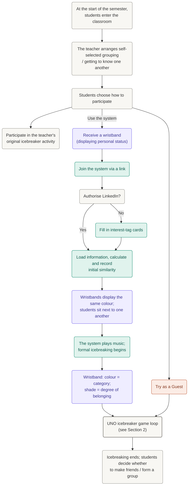
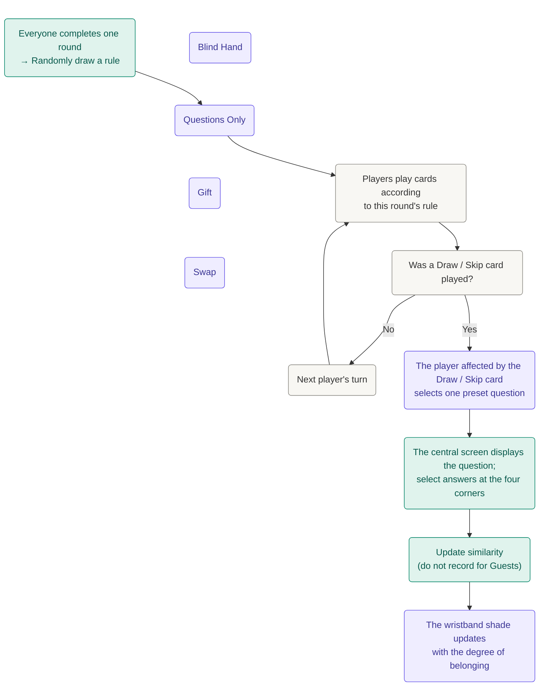
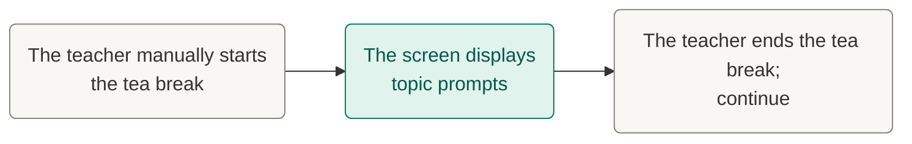
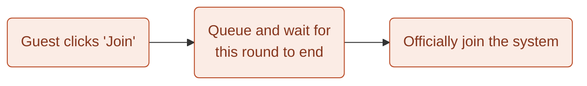

# Ice Breaker Flowcharts - Version 4

DECO3500 - Ice Breaker Team Project

## 1. Main Flowchart

**Legend**

- Green: System action.
- Purple: Wristband / in-person action.
- Orange: Guest path.
- Neutral: General step / decision.

## 2. UNO Game Loop

The four listed rule options are alternatives: Blind Hand, Questions Only, Gift, and Swap.

**Loop:** After everyone completes one round, return to the top and randomly draw another rule.

### Parallel Flow: Tea Break

### Parallel Flow: Guest Joining

