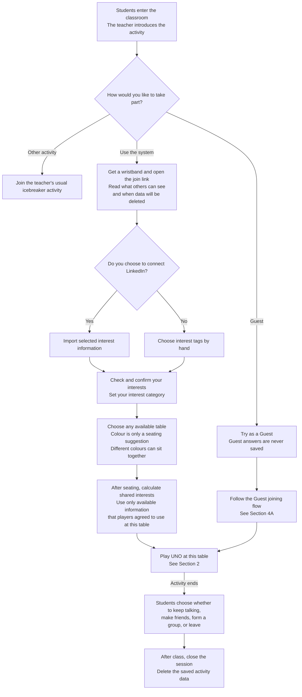
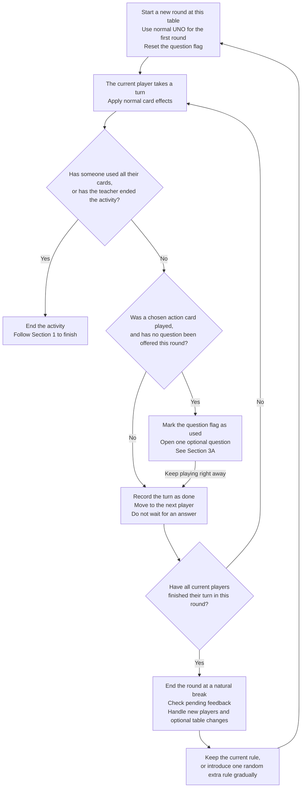
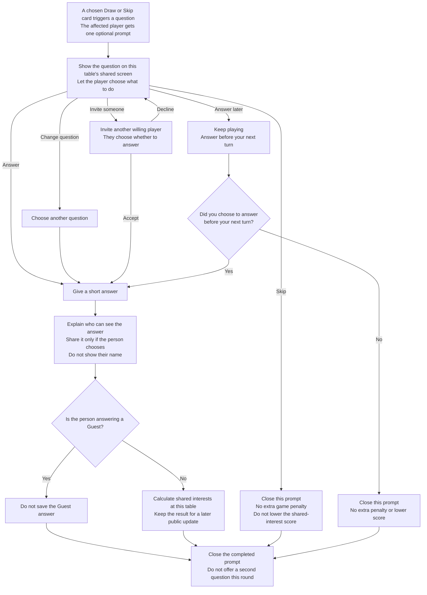
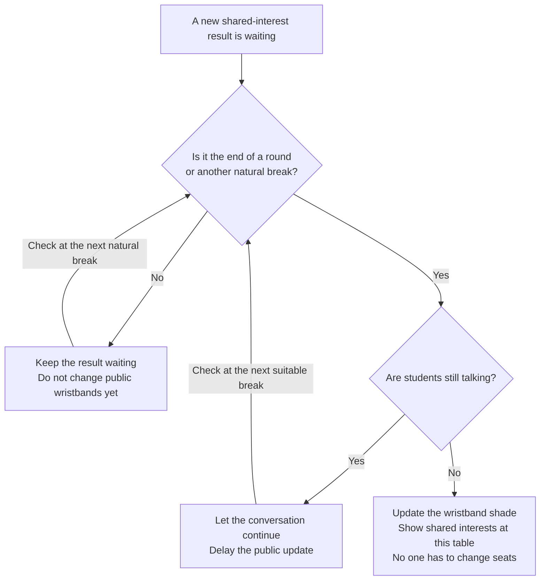
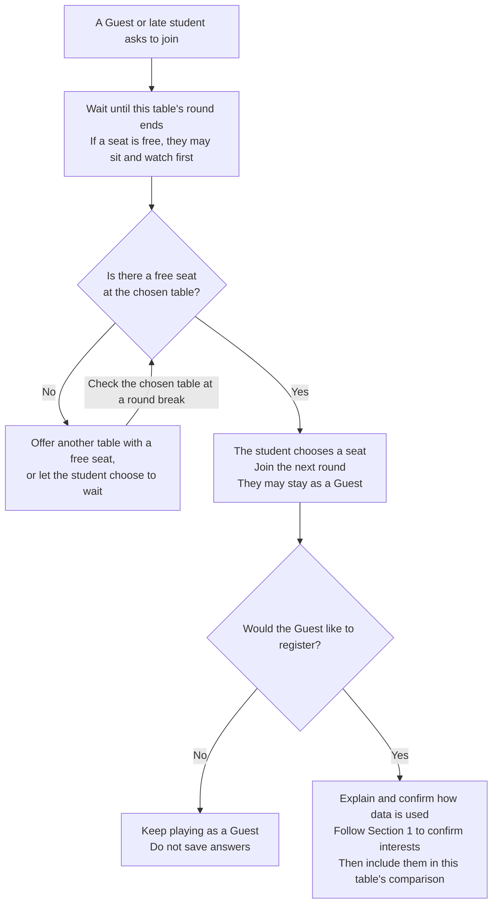
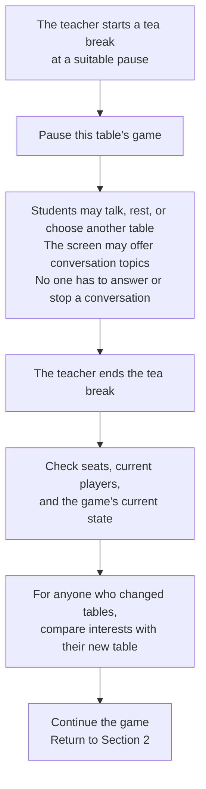

# Icebreaker Flowchart - Version 5

English Markdown version of **IceBreaker_Flowchart_Version5.pdf**.

This file uses Mermaid flowcharts. Open it in a Markdown viewer that supports Mermaid to see the diagrams. Edit the text inside each `mermaid` block to change a step or a connection.

## Design perspectives

| Perspective | Main focus |
| --- | --- |
| Social | Let students choose how to take part. Questions are optional. |
| Technological | Use wristbands and shared screens to support interaction. Separate score calculation from public updates. |
| Spatial | Let students choose seats. Make screens and controls easy to see and reach. Keep paths clear. |
| Temporal | Keep the game moving. Offer no more than one question per round. Update public feedback at a suitable break. |

## 1. Join, choose a seat, and finish

**Wristband meaning**

- Colour shows an interest category. Also use text or a symbol.
- Shade shows shared interests with players at the same table.
- It does not show popularity or willingness to talk.
- A colour or shade change does not require anyone to move.

**Sharing and saving**

- Before sharing an answer, explain who can see it.
- Let the person choose whether to share it. Do not show their name with the answer.
- Do not treat a skipped or unanswered question as negative information.
- Never save Guest answers.

## 2. UNO game loop

**What counts as one round?**

A round ends when each current player has taken a turn, been skipped, passed, or left the table. A skipped turn counts as done. Remove a player who leaves from the turn order. A round does not mean that every player has used all their cards.

**Extra rules**

Introduce changes gradually: Hidden cards, Optional questions, Give a card, or Swap cards. The Optional questions rule does not require everyone to ask or answer a question.

## 3. Optional questions and wristband feedback

### 3A. Optional question - runs alongside the game

UNO continues on every path. Questions do not pause the game. Skipping or not answering is never used as negative interest information.

### 3B. Public wristband update

Private notifications may appear right away. Public wristband feedback waits for a suitable break. Calculating a result and showing it publicly are separate steps.

## 4. New players, tea breaks, and space

### 4A. Guests and late arrivals

### 4B. Tea breaks and optional table changes

**Space at each table**

- Provide one shared screen per table.
- Everyone should be able to see the question and comfortably reach the four corner controls.
- Show interest categories with text or symbols as well as colour.
- Keep paths clear and provide seats that are easy to use.
- Seat choices and table changes are voluntary.

**Details still to define**

The PDF does not set the exact shared-interest formula or wristband shade scale. Define these before implementation. Shared interests do not measure willingness to talk. Unanswered questions must not count as negative information.

## Scope of this file

This file translates the Version 5 PDF flow. It is a design flow, not a statement that every feature is connected in the current prototype. For example, LinkedIn remains an optional path in the PDF; the current prototype uses manual interest tags.
